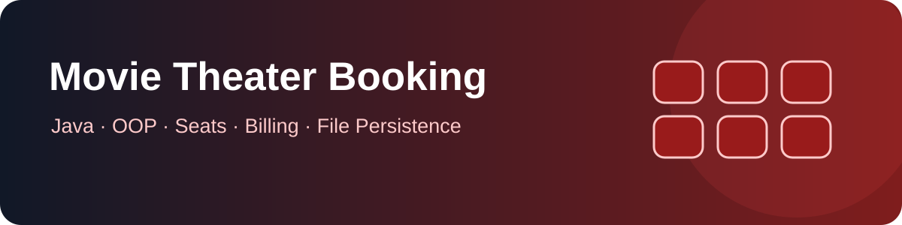
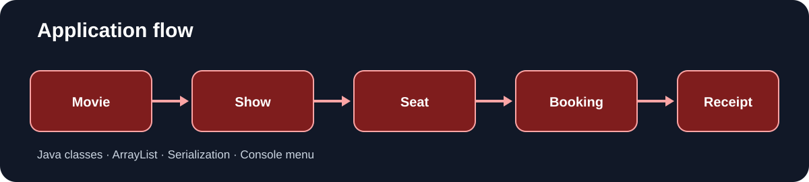

# Movie Theater Seat Booking System

<p align="center"></p>

<p align="center"><strong>A Java console project demonstrating object-oriented design, seat booking, billing and file persistence.</strong></p>

<p align="center"></p>

## Features

- Movie and show selection
- Multi-screen seat layout
- Customer details and booking receipts
- Seat availability and booking cancellation
- Fare calculation, discount and GST demonstration
- Save and load booking data using Java serialization
- Admin menu for managing sample movie/show data

## Technology

- Java 11+
- OOP: classes, encapsulation and object relationships
- Collections: `ArrayList`
- File I/O and serialization

## Run locally

From the repository root:

```bash
mkdir -p out
javac -d out project_work/src/project_work/Movie_Theater_SheetBooking.java
java -cp out project_work.Movie_Theater_SheetBooking
```

The program writes its serialized booking data to `movie_booking.dat` in the current working directory. Keep generated data and compiled `.class` files out of Git.

## Project structure

```text
repo06/
├── assets/
│   └── movie-booking-banner.svg
├── project_work/
│   └── src/
│       └── project_work/
│           └── Movie_Theater_SheetBooking.java
├── .gitignore
└── README.md
```

## Important limitations

This is an educational console application, not a production ticketing service. It does not provide real payment processing, secure server-side authentication, concurrent seat locking or a production database. Do not use real customer information in sample runs. The sample admin check in the source is not secure authentication.

## Learning outcomes

Encapsulation, object relationships, collections, menu-driven applications, serialization, file handling and basic billing calculations.

## Maintainer

[Anurag Chaurasiya](https://github.com/anuragchaurasiya)